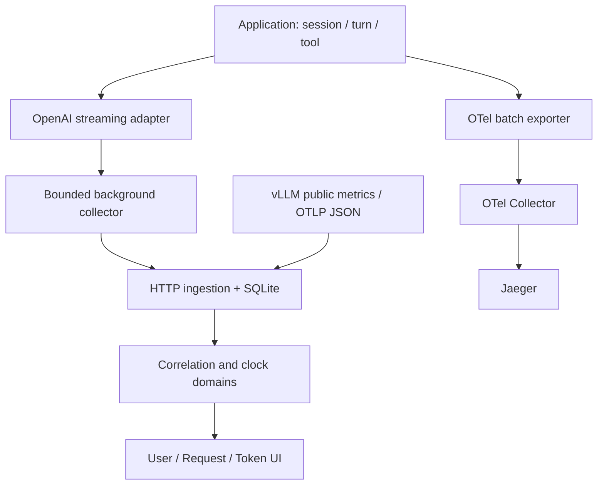

# Architecture

InferTrace keeps collection on the application boundary and separates observation
from inference. A client does not need to patch engine source for baseline data.

## Components
| Module | Responsibility |
|---|---|
| tracing.py | Owned/global provider integration, context propagation, scoped IDs, tool spans |
| events.py | Strict 1.0 envelope, privacy-limited fields, explicit provenance and missing data |
| stream.py | Completion/chat SSE, disconnect/cancel errors, chunks and request boundaries |
| collector.py | Bounded queue, background batches, trace sampling, pressure admission and counters |
| adapters.py / otlp.py | HTTP event export, aggregate Prometheus observations, OTLP JSON span boundaries |
| storage.py / api.py | Idempotent transactional SQLite batches, bounded queries, local HTTP/UI serving |
| correlation.py | Parent-span joins, explicit clock mapping, overlapping intervals and causal paths |
| static/ | Dependency-free accessible navigation, filters, zoom, evidence inspector |

## One Trace
Session, turn, model request and tool operation use OTel spans. Streaming HTTP
propagates W3C headers and X-Request-ID. Events persist trace/span/session/turn/
request identifiers. Consumer context is restored between generator yields;
interleaved requests remain siblings. Caller must close partially consumed
iterators. Provider configuration is application startup work, not request work.

## Three Waterfalls
User lanes group sessions, turns and model/tool requests. Request lanes contain
only observed intervals. Token lanes show engine events only when supplied;
baseline HTTP data is labeled Client chunk. A public OTLP JSON adapter preserves
span boundaries and parent IDs; it cannot turn span duration into decode phases
or token timing. Parent-span joins require explicit ancestry in the same trace.

## Time and causality
Monotonic process clocks stay independent. Explicit ClockAnchor offsets and
uncertainty are required for cross-domain alignment. Wall-clock receipt never
establishes GPU timing. Critical paths use only explicit parent_event_id edges;
an iterative graph algorithm handles long traces and rejects cycles.
No time-proximity joins or unsupported GPU attribution are performed.

## Resource bounds and failure
The inference path performs no network/disk telemetry export. Queue, batch and
sampling-decision memory are bounded. Schema bounds limit individual events;
HTTP export splits at ingestion byte/count limits. Failed/overflowed observations
are dropped and counted. Shutdown is time bounded; blocked custom exporters may
outlive close as daemon threads. Disabled mode skips spans/headers/events.

## Deployment boundary
The MVP combines UI/API/event ingestion in one non-root container. SQLite uses a
named volume. OTel spans flow separately to Jaeger. Compose publishes only
loopback ports. This is a trusted local development service, not an authenticated
multi-tenant collector. No production-readiness claim precedes M9.
