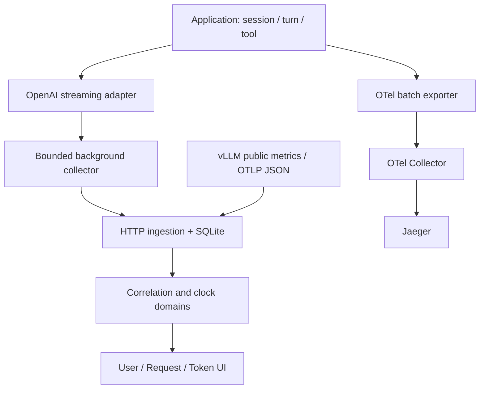

# Architecture

InferTrace keeps collection on the application boundary and separates observation
from inference. A client does not need to patch engine source for baseline data.

## Components
| Module | Responsibility |
|---|---|
| tracing.py | Owned/global provider integration, context propagation, scoped IDs, tool spans |
| events.py | Strict 1.0 envelope, privacy-limited fields, explicit provenance and missing data |
| stream.py | Completion/chat SSE, disconnect/cancel errors, chunks and request boundaries |
| collector.py | Bounded queue, background batches, trace sampling, pressure admission and counters |
| adapters.py / otlp.py | HTTP event export, aggregate Prometheus observations, OTLP JSON span boundaries |
| storage.py / api.py | Idempotent transactional SQLite batches, bounded queries, local HTTP/UI serving |
| correlation.py | Parent-span joins, explicit clock mapping, overlapping intervals and causal paths |
| static/ | Dependency-free accessible navigation, filters, zoom, evidence inspector |

## One Trace
Session, turn, model request and tool operation use OTel spans. Streaming HTTP
propagates W3C headers and X-Request-ID. Events persist trace/span/session/turn/
request identifiers. Each streaming iterator executes in a dedicated copied context bound at first
consumption. No generator-owned context token is attached to the caller's context;
new consumer spans, interleaved streams and cross-thread close retain isolation. Caller must close partially consumed
iterators. Provider configuration is application startup work, not request work.

## Three Waterfalls
Session and turn helpers accept collector= and emit lifecycle events, including
empty turns and failure outcomes. User lanes show those intervals alongside
model/tool requests. Request lanes contain
only observed intervals. Token lanes show engine events only when supplied;
baseline HTTP data is labeled Client chunk. A public OTLP JSON adapter preserves
span boundaries and parent IDs; it cannot turn span duration into decode phases
or token timing. Parent-span joins require explicit ancestry in the same trace.

## Time and causality
Monotonic process clocks stay independent. Explicit ClockAnchor offsets and
uncertainty are required for cross-domain alignment. Wall-clock receipt never
establishes GPU timing. Critical paths use only explicit parent_event_id edges;
an iterative graph algorithm handles long traces and rejects cycles.
No time-proximity joins or unsupported GPU attribution are performed.

## Resource bounds and failure
The inference path performs no network/disk telemetry export. Queue, batch and
sampling-decision memory are bounded. Schema bounds limit individual events;
HTTP export splits at ingestion byte/count limits. Failed/overflowed observations
are dropped and counted. Shutdown is time bounded; blocked custom exporters may
outlive close as daemon threads. Disabled application configuration skips provider setup, session/turn spans,
request spans, headers, context copies and event allocation. Individual lifecycle
helpers also accept enabled=False. Metrics HTTP responses are decoded incrementally
with a 4 MiB retained-body limit; non-finite samples become explicit missing values.

## Deployment boundary
The MVP combines UI/API/event ingestion in one non-root container. SQLite uses a
named volume. OTel spans flow separately to Jaeger. Compose publishes only
loopback ports. This is a trusted local development service, not an authenticated
multi-tenant collector. No production-readiness claim precedes M9.

## Query snapshots and upgrades
SQLite migration adds indexed span ancestry/source columns while retaining old
event payloads. Recursive ancestry is resolved before request/session/source
filters and page selection; ambiguous scopes and aggregate metrics are never
assigned to a request. The latest view orders by ingestion row ID, independent of
unrelated clock domains. Snapshot IDs restrict both selection and ancestry so
new arrivals do not shift older pages. Page boundaries are explicitly partial.
Queries may traverse stored ancestry and are intended for MVP-sized local logs;
they do not execute on the inference producer thread.

OTLP retries compare immutable upstream span data and retain the first receipt
timestamp. A changed span with the same deterministic event ID remains a conflict.
